# Proofline — Evidence-Backed Scope, Change-Order & PayPal Proof Engine

> **Tagline:** *Every milestone agreed. Every change priced. Every payment traceable.*  
> **Official Route:** [`/proofline`](http://localhost:3000/proofline)  
> **Target Audience:** Cross-border independent professionals (e.g., designers, developers, agencies in India/global) billing international clients via PayPal.

---

## 1. The Core Problem Solved

Freelancers rarely lose money because they cannot create an invoice. **They lose money because client scope expands informally in chat and email**, but pricing and evidence trails do not change with it. When the client later questions the work or invoice, the freelancer has only fragmented screenshots and disputed recollections.

Proofline eliminates this root cause by establishing an unbroken, tamper-evident chain connecting:
1. **What the client actually asked for** (verbatim source spans and exact character offsets).
2. **What both parties explicitly accepted** (immutable `ScopeVersion` with SHA-256 digest).
3. **What changed during the work** (automatic scope creep detection & priced change order addenda).
4. **What was actually delivered** (server-side SHA-256 deliverable fingerprinting and deterministic QA).
5. **What PayPal actually confirms** (authoritative server-side readback & webhook reconciliation).

---

## 2. The 5-Stage Proof-to-Payment Workflow

```mermaid
flowchart LR
    A["Stage A: Chat Intake"] -->|Source Quotes + Spans| B["Stage B: Scope Versioning"]
    B -->|SHA-256 Frozen Agreement| C["Stage C: Scope Creep Guard"]
    C -->|Detects Unpriced Addition| D["Stage D: Priced Change Order"]
    D -->|Client Acceptance| E["Stage E: PayPal Invoicing Rails"]
    E -->|Server Readback & Webhook| F["Stage F: Verifiable Proof Receipt"]
```

### Stage A — Brief-to-Scope Extraction
- Ingests raw chat messages, emails, or project briefs.
- Extracts deliverables, measurable acceptance criteria, and payment milestones.
- **Zero-Hallucination Policy:** If prices, deadlines, or deliverables are missing or ambiguous in the source text, Proofline returns `null` and sets `needs_confirmation: true`. It **never** fabricates financial terms or deadlines.
- Links every extracted field to its exact character offset in the source document.

### Stage B — Immutable Scope Versioning
- Both parties review and accept the scope draft.
- Proofline computes a **FIPS 180-4 SHA-256 content digest** over canonical sorted JSON.
- Creates `ScopeVersion v1` (`status: "ACCEPTED"`).
- Any subsequent edit creates a new version; accepted versions are cryptographically immutable.
- Stale version hash rejection prevents clients or freelancers from accepting outdated terms.

### Stage C — Scope-Drift & Change-Order Intelligence (The Signature Moment)
- When a client sends a new message (e.g. *"Can you also add mobile responsive views and Flutter export?"*), Proofline evaluates it against the accepted scope.
- Classifies the message into one of four deterministic categories:
  - `IN_SCOPE`: Already covered under accepted deliverables.
  - `CLARIFICATION`: A question or status inquiry; no price/timeline adjustment needed.
  - `CHANGE_REQUEST`: New work, formats, or accelerated deadlines not in the accepted scope.
  - `AMBIGUOUS`: Insufficient information; flagged for human clarification.
- For `CHANGE_REQUEST`, Proofline calculates an advisory price delta (e.g., `+$650.00 USD`) and schedule impact (e.g., `+4 business days`) and prepares a formal change order addendum.
- **Critical Guardrail:** No new work is treated as agreed until the change order is explicitly accepted by both parties.

### Stage D — Deliverable Evidence & SHA-256 Verification
- Artifact upload with server-side SHA-256 fingerprinting.
- Deterministic checks: non-zero byte check, file size ceiling (< 25MB), allowed MIME type/extension, safe filename sanitization (prevents path traversal).
- Advisory AI criteria review: Evaluates artifacts against accepted milestone criteria (`PASS`, `NEEDS_REVIEW`, `NOT_VERIFIED`). AI advice is advisory only; human client maintains final approval authority.

### Stage E — PayPal Sandbox Invoicing & Authoritative Reconciler
- Direct invoice creation on PayPal Sandbox via Invoicing v2 REST API (`POST /v2/invoicing/invoices`).
- Dispatches invoices directly to the client's email.
- **Zero Client Spoofing:** The browser **never** declares an invoice paid. Payment transitions to `PAID` exclusively through verified PayPal webhook events or authoritative server-side readbacks (`GET /v2/invoicing/invoices/{id}`).
- Reconciles net amounts in integer minor units (paise/cents) to eliminate floating-point calculation errors.

### Stage F — Tamper-Evident Proof Receipt
- Compiles the entire journey into a single verifiable cryptographic record:
  - Original source citations and character spans.
  - Accepted Scope Version hash.
  - Approved Change Orders.
  - Deliverable SHA-256 checksums and deterministic test results.
  - Client approval decisions.
  - PayPal provider invoice IDs and settlement timestamps.
  - Append-only cryptographic hash chain:  
    $$H_n = \text{SHA-256}(H_{n-1} \parallel \text{timestamp} \parallel \text{actor} \parallel \text{action} \parallel \text{payload})$$
  - Provenance badges: `CLIENT_CLAIM`, `FREELANCER_STATEMENT`, `SYSTEM_CHECK`, `PAYPAL_CONFIRMED`, `AI_INFERENCE`.
- 1-Click export to standalone JSON packet and print-ready format.

---

## 3. PayPal Invoicing & Webhook Architecture

| Component | PayPal REST Endpoint | Invariant / Policy Rule |
| :--- | :--- | :--- |
| **OAuth 2.0 Token Cache** | `POST /v1/oauth2/token` | Tokens cached in memory with a 60s safety buffer; zero leaked credentials. |
| **Invoice Creation** | `POST /v2/invoicing/invoices` | Policy Firewall verification; integer minor units; idempotency key header. |
| **Invoice Dispatch** | `POST /v2/invoicing/invoices/{id}/send` | Dispatched only after freelancer review and policy clearance. |
| **Authoritative Readback** | `GET /v2/invoicing/invoices/{id}` | Authoritative status (`DRAFT`, `SENT`, `PAID`, `CANCELLED`). |
| **Webhook Deduplication** | `POST /api/paypal/webhook` | Deduplicated by PayPal `event.id`; verifies cryptographic transmission signatures. |

---

## 4. How to Demo (2-Minute Script for Judges)

1. **Open Proofline:** Navigate to [`/proofline`](http://localhost:3000/proofline).
2. **Review Intake & Scope v1:** Switch to Tab 1. Notice how the client chat is source-cited, deliverables have measurable acceptance criteria, and the agreement is frozen with a SHA-256 digest ($4,000.00 USD).
3. **The Signature Scope Creep Moment (Tab 2):**
   - Click the preset: *"Scope Creep: +Mobile & Flutter"*.
   - Click **"Evaluate Against Scope v1"**.
   - Watch Proofline immediately classify the drift as `CHANGE_REQUEST` and prepare a priced change order addendum (+ $650.00 USD, +4 business days).
   - Click **"Accept Change Order & Freeze Scope v2"**. Watch Scope v2 become the active agreement ($4,650.00 USD) without mutating Scope v1!
4. **PayPal Sandbox Invoicing (Tab 3):**
   - Click **"Create PayPal Invoice"** on Milestone 1.
   - Show the generated PayPal Invoice ID and hosted checkout link.
   - Click **"Send Invoice to Client"** followed by **"Simulate Client Payment"**.
   - Show the authoritative reconciliation to `PAID`.
5. **Verifiable Proof Receipt (Tab 5):**
   - Show the Master Receipt Fingerprint and the verified green status: `Audit Chain Verified Valid`.
   - Scroll through the chronological audit ledger showing provenance badges (`PAYPAL_CONFIRMED`, `AI_INFERENCE`, `SYSTEM_CHECK`).
   - Click **"Export JSON Packet"** to demonstrate dispute-readiness.
